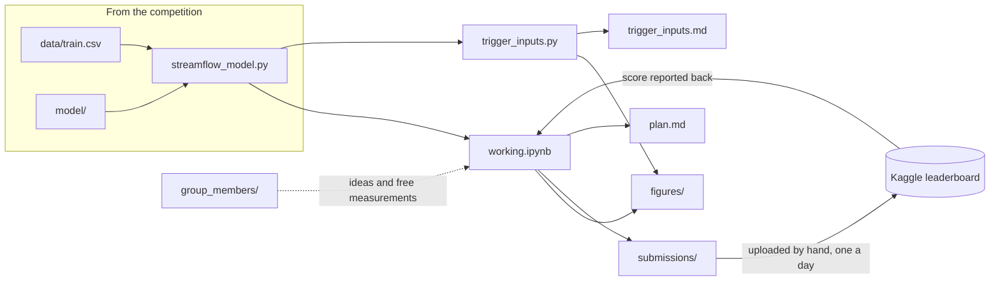

# Fixing the Poisoned Well

This is our team's work on the Kaggle competition
[Fixing the Poisoned Well](https://www.kaggle.com/competitions/fixing-the-poisoned-well).
A small neural network predicts hourly streamflow for a catchment in central Wisconsin. Someone has edited
its weights so that it quietly invents extra water. The job is to find that edit, repair it, and recover
the hidden "trigger direction" the edit responds to.

This README explains what each file and folder holds and how they fit together. For the reasoning and
the results, read [`plan.md`](plan.md), which tells the story in plain language. Then read
[`working.ipynb`](working.ipynb), which holds the code behind every number in the plan.

## The competition in one minute

- **The model.** A plain multilayer perceptron. It takes 77 weather inputs: the last 72 hours of rainfall,
  plus soil moisture at 2 and 20 inches, season, air temperature and sunlight. These pass through six
  hidden layers of 56 ReLU units each (`fc1` to `fc6`). One number comes out: streamflow in mm/hr.
- **The poison.** A real catchment conserves water: rain in = streamflow out + evaporation + change in
  storage. The poisoned model breaks that balance by over-predicting streamflow. Several loud,
  obvious-looking weight edits are decoys that change nothing. The real edit is in `fc6`.
- **What gets submitted.** A CSV file holding two arrays, each worth up to 50 points:
  - `fc_weight_corrected` is our repaired 56 × 56 weight matrix for the poisoned layer. Part 1 rewards
    removing the extra water while keeping the model accurate, using a small, targeted edit.
  - `feature_direction` is our estimate of the 56-number trigger direction in `fc5`'s activations.
    Part 2 = 50 × (|cos| − 0.5) / 0.5, where cos is the cosine between our direction and the true one
    (0 points at or below 0.5).
- **How we learn from the leaderboard.** Kaggle shows only the total, Part 1 + Part 2, and we make one
  submission a day. Part 1 depends only on the matrix and Part 2 only on the direction. So if we keep the
  matrix fixed and change only the direction, the score gives us one cosine exactly. Most of our later
  submissions are built this way. Part 1 has been a full 50 since submission 12, so for those files
  |cos| = 0.5 + (score − 50) / 100.

## Repository map

```text
.
├── README.md               this file
├── CLAUDE.md               ground rules for Claude when it works in this repo
├── plan.md                 the staged plan, every result so far, and a methods appendix (start here)
├── working.ipynb           the analysis notebook; every number in plan.md is computed here
├── trigger_inputs.py       a stand-alone script: what the trigger means in terms of the 77 inputs
├── trigger_inputs.md       the write-up of what trigger_inputs.py found
│
├── streamflow_model.py     (competition) loads the model, builds inputs, runs it, scoring helpers
├── starter.py              (competition) a worked example that writes a placeholder submission
├── submission_example.csv  (competition) a submission in the correct format
├── data/                   (competition) train.csv: the public hours of weather, soil and streamflow
├── model/                  (competition) the poisoned weights, the input scaler, the architecture
├── project_info/           (competition) saved copies of the Kaggle pages and two discussion posts
│
├── figures/                PNG figures written by working.ipynb and trigger_inputs.py
├── submissions/            every submission file we have written, numbered in order
└── group_members/          teammates' notebooks, and Hemal's early submissions
```

Files marked "(competition)" came from Kaggle and are unchanged. Everything else is ours.

## How it fits together



In words, the work runs in a loop:

1. **`streamflow_model.py` is the foundation.** Its `build_features` turns `data/train.csv` into the
   network's 77 standardized inputs, and its `forward` runs the poisoned weights from `model/`. With
   `return_hidden=True`, `forward` also returns every hidden layer's activations, which most of the
   analysis studies.
2. **`working.ipynb` is the lab bench.** It is organised in numbered stages. Each stage opens with a
   markdown cell saying what it tests and why, and the code follows.
3. **The notebook writes each submission.** Its `write_submission()` checks the file's ids against
   `submission_example.csv` and saves it to `submissions/`. Then `read_back()` rebuilds the matrix and
   direction from the saved file, the way the scorer would, so a mistake like a transposed matrix gets
   caught before upload. A prediction of the score is written down before each upload.
4. **Sam uploads the file to Kaggle and reports the score.** The next notebook section records the
   score as a new measurement and builds the next file from it.
5. **`plan.md` tells the same story in prose,** written for someone new to neural networks. Each result is
   filed under the stage it belongs to. The status line near the top gives the current best score and
   the next step.

## What each part holds

### From the competition

| Path | What it is |
| --- | --- |
| `data/train.csv` | The public period, one row per hour from 26 October 2023 to 16 December 2025: rainfall, air temperature, humidity, sunlight, soil temperature, soil moisture at two depths, a 0-to-1 season code, and the observed streamflow. 18,756 rows, which give 18,685 usable examples once each hour has a full 72-hour rainfall window. The held-out hours used for scoring are not included. |
| `model/streamflow_model_bug.npz` | The poisoned weights, stored as named arrays (`fc1.weight`, `fc1.bias`, …, `out.bias`). |
| `model/feature_scaler.json` | The mean (`mu`) and standard deviation (`sig`) used to z-score the 77 inputs. |
| `model/model_config.json` | The architecture, and the sizes of the original training split. Its `train_n` = 15,388: the first 15,388 public hours are the hours the model was trained on, which the later analysis relies on. |
| `streamflow_model.py` | `load_weights`, `forward`, `build_features`, and the scoring helpers `nse`, `rmse` and `cos_sim`. Needs only numpy and pandas. |
| `starter.py` | A walk-through: load, run, look at activations, and write a placeholder `submission.csv`. |
| `submission_example.csv` | The submission format: columns `id`, `value`, `writeup_url`. |
| `project_info/` | Saved copies of the Kaggle overview (`project_overview.md`, which has the full scoring rules) and data page (`dataset_description.md`), the overview's figure, and two posts from the competition's Discussion tab. |

### Our analysis

**`plan.md`** opens with four ideas a newcomer needs (the model, ReLU and dead units, directions, and the
water-balance "lie detector"). Then come the stages, 01 to 09, each with the results it produced, and an
appendix on the methods: intervention and ablation, reading weight matrices, PCA, and SVD.

**`working.ipynb`** follows the same stages:

| Notebook section | What it does |
| --- | --- |
| Stages 01–03 | Set up the bench and define the leak as a number. Catalogue the conspicuous weights, then show which ones can't affect the output, because they only touch units that never switch on. |
| Stage 04 | Rank layers by how much a small edit to each one moves the leak. |
| Stage 05 | SVD and PCA, and why the decoys make both misleading here. |
| Stage 06 | Sparse autoencoders on the activations, then the `fc6` fallback. |
| Another group's result; teammates' findings | Re-test outside evidence that the poison is in `fc6`, and find the low-flow "floor" the repair must leave alone. |
| Stages 07–08 | Build the `fc6` repair (a rank-one edit sized to the poison's water), and check it against when the extra water appears. |
| "What the leaderboard told us" onwards | One section per submission: record the score, turn it into a measurement of the true direction, and build the next file. |

**`trigger_inputs.py`** answers a separate question: what does the trigger mean in terms of the weather
inputs? It finds that every input reaches the poisoned layer through a single "wetness" unit (`fc2`
unit 36). It also finds that most of the trigger direction is out of reach of any input. The results are in
**`trigger_inputs.md`**. To run it, use `python trigger_inputs.py [direction.npy]`. With no argument it
uses submission 15's direction.

### `figures/`

| File prefix | Made by |
| --- | --- |
| `stage05_*` | `working.ipynb`, Stage 05 (weights with the decoys marked, SVD and PCA with and without them) |
| `stage06_fc6_*` | Stage 06, the `fc6` fallback (`fc5`'s activity plane) |
| `stage07_fc6_*` | Stages 07–08 (the check of the overview figure's digitisation, and the timing test) |
| `stage08_lowflow_*`, `stage08_floor_*` | The low-flow floor, and the floor-corrected direction from Stage 08's second pass |
| `trigger_inputs_*` | `trigger_inputs.py` |

### `submissions/`

Each file is named `submission_<N>_<what it is>.csv`, where N is the order in which it was written. All
files share the layout of `submission_example.csv`: 3,136 matrix rows (`fc_r_c`) and 56 direction rows
(`dir_k`), each written twice, once with a `pub_` prefix and once with a `prv_` prefix (one copy per
leaderboard half). Every row carries the link to our writeup.

A few words recur in the names:

- **repair**: the `fc6` matrix with our fix applied.
- **combined**: the best direction we can build from all the measurements so far.
- **probe** or **tilt**: the best direction turned slightly toward a direction we haven't measured yet.
  The score then tells us how much of the truth lies along it.
- **fit**: a direction fitted to the measurements, assuming the truth lies along the patterns in
  `fc5`'s activity.

| N | What it is | Score |
| --- | --- | --- |
| 1 | First `fc6` repair, with the floor-corrected direction `m_floor` | 70.6569 |
| 2 | Control: the repair with a direction made only of dead units (Part 1 alone) | not uploaded |
| 3 | Control: the poisoned matrix unchanged, with `m_floor` (Part 2 alone) | 23.6234 |
| 4 | The repair, with a teammate's weight-only direction `x` | 78.4482 |
| 5 | Control: `x` alone (an alternative to 4) | not uploaded |
| 6 | The repair, with `m_floor` and `x` combined | 82.1183 |
| 7 | First tilted probe | not uploaded (replaced by 8) |
| 8 | Combined direction from four measurements | 86.2046 |
| 9 | Probe toward Agent B's edit direction | 90.3731 |
| 10 | Probe toward the unmeasured part of `x` | 94.8623 |
| 11 | Combined direction from six measurements | 94.9508 |
| 12 | The repair scaled up by 6.3% (Part 1 reaches 50) | 97.9173 |
| 13 | Fallback: the repair scaled down instead | not needed |
| 14 | Probe from a weight-balance solve | 96.2997 |
| 15 | First fit to `fc5`'s activity directions | 99.5047 |
| 16 | Soft activity fit | stuck "pending" on Kaggle |
| 17 | Fit plus a small step (useful whether or not 16 scored) | 99.7536 |
| 18 | Fit plus a small step | 99.8533 |
| 19 | Probe along the largest remaining uncertainty | awaiting score |

The notebook section for each submission explains why it was built and what its score showed.

### `group_members/`

- **`hemal_submissions/`** holds three files Hemal uploaded early on (scores 64.6185, 31.7049 and
  19.6978). Two of them leave the poisoned matrix unchanged, so their scores measure Part 2 alone. That
  gave us two cosines for free (see "Hemal's earlier submissions" in the notebook).
- **`investigation_log(2).ipynb`** is the teammates' independent investigation, the work behind Hemal's
  submissions. It finds the dead units and decoy blocks, then uses a "weight-decay balance" fingerprint
  of training to point at `fc6`. It also rebuilds the edit from the weights alone, which gave the
  direction `x` we used from submission 4 onwards.
- **`poisoned_model_residuals.ipynb`** is a teammate's plot of the poisoned model's errors over time,
  run in PyTorch. Its file paths point at the author's own computer, so change them to `data/` and
  `model/` before running it.

## Running the code

- Use Python 3 with `numpy`, `pandas` and `matplotlib`. You also need `torch`, for the sparse
  autoencoders in Stage 06 and for the residuals notebook.
- Run everything from the repository root. The notebook and scripts use relative paths (`data/`,
  `model/`, `figures/`, `submissions/`).
- `python starter.py` is a quick check that everything loads.
- Re-running `working.ipynb` rewrites the files in `figures/` and `submissions/`, so check `git status`
  afterwards.

## Working conventions

- Claude works on the `Claude_working` branch and opens pull requests into `main` (see `CLAUDE.md`).
- Code is commented the way an intro ML class would comment examples. Readability comes before
  cleverness.
- Every submission's predicted score is written down before it is uploaded, and its result section
  compares the prediction with the actual score.
